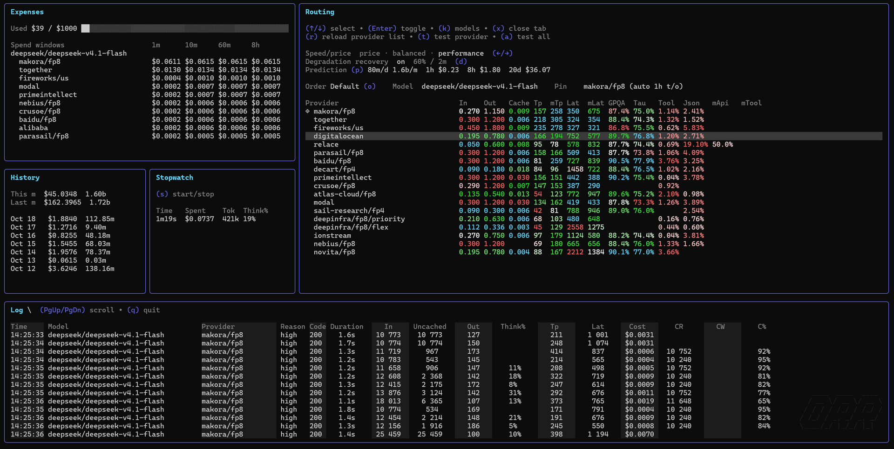

# orr

`orr` is a local OpenRouter proxy. It keeps the model selected by your client
and applies the provider preferences stored in its database to generation
requests.

It gives you provider routing, manual pins, live performance and spend data, and
a terminal dashboard without recording prompts or API keys.



> A valid OpenRouter API key is required. `orr` does not support keyless use.

## Quick start

Install from the public repository (Git is required, plus Go 1.23+ or Docker
with Buildx):

```sh
git clone https://github.com/mikael-titinovskii/orr.git
cd orr
./install.sh
orr serve
```

On Windows PowerShell:

```powershell
git clone https://github.com/mikael-titinovskii/orr.git
Set-Location orr
.\install.ps1
orr serve
```

The installer asks for `OPENROUTER_API_KEY`, builds `orr`, and adds it to
`PATH` where needed. Set `ORR_OPENROUTER_API_KEY` beforehand for unattended
installs. It also configures installed Kimi Code and OpenCode clients when it
finds them.

Without Go 1.23+, the installer builds `orr` for your platform with Docker and
the repository's `Dockerfile`. Docker is used only for building; `orr` still
runs directly on your machine.

Point any OpenAI-compatible client to:

```text
http://127.0.0.1:8787/v1
```

## Configure routing

Keep secrets and runtime options in `.env`, which is ignored by Git. Provider
order, manual pins, and measurement history live in one SQLite database that
`orr` creates and migrates itself.

```dotenv
# .env
OPENROUTER_API_KEY=sk-or-...
ORR_LISTEN=127.0.0.1:8787
ORR_TUI=true
```

The database is `orr.db` in the platform data directory
(`%LocalAppData%\orr` on Windows, `$XDG_DATA_HOME/orr` or
`~/.local/share/orr` elsewhere). Point `ORR_DB_FILE` at another path to keep
several installations apart. A relative value resolves against the dotenv
file's directory.

Routing rows are written by the dashboard, the management API, and background
refreshes; the database is not meant to be edited by hand. `orr` creates an
empty entry for a new model and refreshes its compatible providers
automatically, and it imports a `stats.json` left by an older version once, then
renames it to `stats.json.imported`. `providers.yaml` from an older version is
not migrated; delete it.

Run one `orr serve` per database. Two processes on the same file serialise on
SQLite's write lock, and the second one's startup can fail while the first holds
it; give each its own `ORR_DB_FILE` instead.

Keep `ORR_LISTEN` on `127.0.0.1` unless you deliberately want network access.

## Everyday commands

| Command | Purpose |
| --- | --- |
| `orr serve` | Start the local proxy and dashboard. |
| `orr serve --no-tui` | Start the proxy and management API with plain logs. |
| `orr providers <model>` | List compatible OpenRouter providers for a concrete model id. |
| `orr reset` | Remove the database; preserves `.env`. |
| `orr upgrade` | Pull or download the latest source and rebuild the running binary with Go, or Docker when no usable Go toolchain is installed. |
| `orr completion <shell>` | Print completion setup for bash, zsh, fish, or PowerShell. |

Before tagging a release, update `Version` in `internal/app/main.go` to match
the tag. The dashboard compares this value with release tags, and `orr version`
reports it. After upgrading, restart `orr serve` to run the new executable.

Use a different dotenv file when needed:

```sh
orr serve --env ./local.env
orr providers moonshotai/kimi-k3 --env ./local.env
```

Process environment variables override values from the dotenv file by default.
Use `--prefer-env-file` when the selected file should win for variables it
defines:

```sh
orr serve --prefer-env-file
orr providers moonshotai/kimi-k3 --env ./local.env --prefer-env-file
```

## Management API

`orr serve` also exposes a REST API at `http://127.0.0.1:8787/api/v1`, with or
without the dashboard. Local management requests require no authentication header.
ORR reads `OPENROUTER_API_KEY` through its existing environment/dotenv configuration
for upstream operations. Read stats and model/provider state, set or clear manual
pins, and submit provider refresh or benchmark jobs. Benchmark jobs make billable
upstream requests. Poll the job URL returned in the `Location` header.

See the [REST API specification](docs/rest-api.md) for endpoints, JSON fields,
examples, limits, and errors. Management changes share the dashboard's live
routing state and persist manual pins to the database.

The management API is accessible to anyone who can reach `ORR_LISTEN`, so keep
the default loopback address for local use.

While running, open [the API reference](http://127.0.0.1:8787/api/docs) or download
[OpenAPI JSON](http://127.0.0.1:8787/api/openapi.json) to import into an API client.
Both documentation endpoints are public and bundled into the binary, with no
CDN dependencies. The [schema source](internal/app/api_docs/openapi.json) is also
available in the repository.

## Dashboard

An interactive terminal opens the dashboard; redirected output uses plain logs.
Set `ORR_TUI=false` or pass `orr serve --no-tui` to always use plain logs.
The indicator beside Log spins while requests are in flight.

The useful controls are:

| Key | Action |
| --- | --- |
| `↑` / `↓` | Select a provider. |
| `Enter` | Toggle a manual pin for the selected provider. |
| `←` / `→` | Move the speed/price control between its stops. |
| `d` | Turn degradation recovery on or off. |
| `p` | Change the day the `Prediction` line prices: 10m to 200m tokens in steps of ten million. |
| `Tab` | Switch between recently used models. |
| `k` | Search the model catalog and open the highlighted model in a tab. |
| `x` | Close the current model tab. |
| `r` | Refresh and rank providers for the current model. |
| `o` | Change the provider table's display order: routing order, then each metric column. |
| `t` | Benchmark the selected provider. |
| `a` | Benchmark every listed provider. |
| `s` | Start or stop the spend stopwatch. |
| `q` / `Ctrl+C` | Stop the proxy cleanly. |

`o` reorders the rows on screen only: the routing order, the pin, and the
stored provider order stay as they are, so requests keep following the same route.
The `Order` field in the routing pane names the active column, the column's own
name is highlighted in the table, and each press of `o` moves to the next column
before returning to `Default`. Prices sort cheapest first, `Tp`/`mTp`, `GPQA`, and
`Tau` fastest or highest first, latencies lowest first, and the error columns
cleanest first; a provider with a blank cell for the active column sorts below
every provider that reports one.

`k` opens a search box over the dashboard. It lists the models the dashboard
already knows and, once the OpenRouter catalog arrives, every model the catalog
publishes, matched by id or display name; ↑/↓ moves the cursor and `Enter` opens
the highlighted model. The model joins the tab list even if nothing has
requested it yet, and its routing entry is created in the database so its
compatible providers can be listed and pinned. `x` closes the displayed tab and moves to
the next one; a request that completes for the closed model afterwards brings it
back, so closing a tab whose traffic is still in flight is temporary.

The `Prediction` line under the header projects what the highlighted provider
would cost over the next hour, the next eight hours, and the next 20 working
days. It prices one day of tokens — 20 million unless `p` changes it — split the
way auto selection's reference request splits it (2,000 uncached input, 30,000
cached input, and 200 output tokens), against that provider's published
prices; the label names the day it prices and the key that changes it. Pressing
`p` cycles 10m to 200m tokens per day in steps of ten million, cycling back to
10m. The label quotes the day and the 20-working-day month it adds up to, so the
volume is never an abstract number: `20m/d 400m/m`. The workload never
follows live traffic, so the figures change only when you change the day, move
the selection to another provider, or that provider reprices; the chosen day
stays in memory and resets with the process. The 20-day value assumes an
eight-hour working day at today's prices. The line stays out when the provider
is blocked for the account, when its catalog entry is missing a price the
projection needs, or when the pane is too narrow for all three horizons.

The provider table includes OpenRouter's published `GPQA` Diamond and `Tau`
Airline benchmark scores, plus `Tool` and `Json` error rates. Benchmark
scores use OpenRouter's rolling 32-day window; error rates match the website's
one-week average of available daily percentages. `mApi` and `mTool`
continue to show errors observed by this proxy.
The legend above the table identifies token rates, first-token latency in milliseconds, OpenRouter benchmarks, and
weekly average OpenRouter tool/JSON error rates, and measured API/tool error rates.
`Tp` (throughput) and `Lat` show OpenRouter's published throughput and
latency; `mTp` and `mLat` show measurements from this proxy. Latency is
time to first token in both cases, matching OpenRouter's definition.
The columns after `mLat` are `GPQA`, `Tau`, `Tool`, `Json`, `mApi`, and
`mTool`. `GPQA` and `Tau` percentages are colored on the
same red–green–teal scale as throughput: higher scores are better, relative to
the listed providers for that model. The provider table shows the cache-read
price in `Cache`; cache-hit percentages are shown in the request log.
The request log's own columns are `In`, `Uncached`, and `Out` for input,
uncached-input, and output tokens, `CR` and `CW` for cache reads and writes,
and `C%` for the cached share of the input.
Every other column of the request log carries a subtle background shade so
values stay distinguishable across the table's full width; failed requests keep
the error red across the whole row.
The table scrolls with provider selection to keep the selected provider's
metrics visible within the pane.
`mApi`, `mTool`, `Tool`, and `Json` use pale red for the lowest nonzero rates, increasing
to the current error red for the highest rates, comparing each column
independently. Equal nonzero rates use the strongest red.

These metrics load in the background, refresh every 15 minutes, and refresh
again after `r`. Missing data stays blank, and zero error rates stay blank.
Scores are matched to exact provider endpoints; ambiguous deployments stay
blank. The data comes from OpenRouter's website API, which can change separately
from its documented API. Fetch failures leave unavailable fields blank. The
metrics stay in memory and influence automatic benchmark selection as described below.
See [OpenRouter's Auto Exacto documentation](https://openrouter.ai/docs/guides/routing/auto-exacto)
for how the benchmarks and tool-call errors are measured.

Manual pins stay until removed. Automatic pins select the best measured
provider, expire after `ORR_PIN_TTL` (one hour by default), and can fail over
after provider-specific 429s or an unavailable endpoint. The recovery benchmark a
failure starts is held to a 30-second cooldown per model, saved in the database,
so a restart does not hand the same failing provider a fresh run.

Measurement follows the models clients ask for. A request for a model whose last
measurement is more than five minutes old starts one catalog refresh and one
provider benchmark for that model, in the background while the request itself
rides the stored pin; a model nobody asks for is never measured. A manually
pinned model is not measured at all: the order under your pin decides nothing, so
the run would spend billable provider requests on a choice it cannot make.
Removing the pin brings the catalog refresh back on the next request and the
benchmark back as soon as that model's last measurement is due, within the same
five minutes. The pings get
their own three-second gate after that model's refresh completes, so a slow
catalog never spends the budget the measurements need, and every provider is
measured until the gate runs out rather than stopping at a share of the field.

Auto selection balances cost, speed, and quality. It estimates the cost and
duration of a typical request from recent traffic (or a reference request of
2,000 uncached input, 30,000 cached input, and 200 output tokens, the shape a
coding client's day actually has). Duration is
time to first token plus output tokens divided by measured tokens per second.
Providers within 1.5 times the field's median duration rank first, followed by
providers with complete prices and trustworthy first-token measurements.
Within these tiers, the lowest quality-adjusted cost-times-duration score wins.

The score's speed/price exponent has three settings, and the Routing pane draws
them as a control just below the key hint:

```
Speed/price  price · balanced · performance  (←/→)
```

The current stop is lit. `←` and `→` move between them: `price` drops duration
out of the score entirely, `balanced` scores the plain `cost * duration`
product, and `performance` buys speed aggressively. The exponents in between are
arithmetic the score still accepts, not settings the pane offers: a decimal
weight is not a decision anyone makes. Like the degradation line below it, the
control carries its own keys so it still says how to move after the key hint has
truncated: a pane too narrow for all three names shows the current stop with the
keys, then the keys alone, and only then truncates the line.
Every keypress re-picks the automatic pin from the measurements already held, so
the pane answers immediately instead of waiting for the next benchmark. The
decision rules are the benchmark's, including the 5% switch threshold, so a move
cannot hand the pin to a provider a benchmark run would have refused at that
weight. The provider order in the database is left alone — only the pin moves — and
catches up on the next benchmark run. The chosen stop is saved alongside the rest
of the routing state, so it survives a restart. A manual pin remains authoritative
and is never overridden by the control.

### Degradation recovery

The speed/price control decides who *should* serve the next request from
measurements orr already holds. Degradation recovery covers the other failure
mode: the chosen provider still answers, but far worse than it did for the same
client minutes ago. It applies only to automatic pins — a manual pin is an
explicit instruction and is never second-guessed.

It compares one provider against itself. For the active route it takes the
answered requests from the last `ORR_DEGRADATION_WINDOW` and the same provider's
successful client requests from the previous 30 minutes, then scores three
ratios, each clamped at 1 so a burst of speed cannot average away a collapse
elsewhere:

```
throughput     recent tokens/sec     / baseline tokens/sec
responsiveness baseline first token  / recent first token
reliability    recent answering share
```

The score is their geometric mean: 1.0 is unchanged, and `ORR_DEGRADATION_THRESHOLD`
(default `0.6`) is the line. One vital at 21% of baseline trips it, two vitals at
46% each trip it, and all three at 60% each trip it — a single wobble does not
spend a benchmark, but a real sag in more than one vital does. A provider needs
`ORR_DEGRADATION_MIN_SAMPLES` answered requests in the window before it is judged
at all, and a provider with no earlier traffic has no baseline, so nothing
happens. Benchmark pings never enter the comparison: they are a fixed 16-token
round whose throughput and latency describe the benchmark, not the client.

A trip runs one bounded catalog refresh and benchmark — the same path provider
failure recovery uses, spending real OpenRouter requests. `ORR_DEGRADATION_COOLDOWN`
(default `10m`) is the minimum gap between attempts for one model, and
`ORR_DEGRADATION_TIMEOUT` (default `10s`) bounds how long that attempt may take.
The convicted provider's pooled benchmark rounds are dropped before that run, so
ranking weighs what it does now instead of a week of healthy pings that no longer
describe it. Ranking still decides the winner under the current speed/price stop,
including its 5% switch threshold, so a benchmark that finds nothing better
leaves the pin alone.

Press `d` to turn degradation recovery on or off; the Routing pane shows the
switch under the speed/price control, with its threshold and window while it is
on. `ORR_DEGRADATION` seeds the state on every start until you press `d`; from
then on the saved switch wins, the same rule the speed/price stop follows. Until
it has been toggled it is not written to the database at all, so the variable
keeps working on installs that never press the key. On a fresh state degradation
recovery starts on.

GPQA, Tau, tool-call success, and JSON success contribute equally to quality.
GPQA and Tau are fractions; success is one minus the published error percentage
divided by 100. Missing or invalid metrics contribute a neutral 0.5. Their
average, `quality`, adjusts the score as
`cost * duration * (1.25 - 0.5 * quality)`, bounded to a 25% discount or penalty
on the cost-speed score. With all quality data missing, the multiplier is 1.
Quality cannot bypass latency tiers or provider health exclusions. A current
eligible automatic pin stays until a challenger improves the adjusted score
by at least 5%. Manual pins remain authoritative.

Quality data loads alongside provider benchmarks even without the dashboard and
shares a 15-minute cache with the dashboard. It is not on the selection path:
the ranking applies the measurements as soon as the pings finish, so a slow
quality fetch cannot delay the pin. Unavailable or expired quality data uses the
neutral adjustment. Failed or cancelled fetches do not start a new cache
lifetime: the next benchmark can retry immediately, and the dashboard retries
after 30 seconds. The dashboard uses the shared data's original fetch timestamp.
Pressing `r` invalidates quality data, including results from fetches already in
flight.

## Integrations

`orr integrate` updates Kimi Code and OpenCode after either client is installed.
You can also change only the OpenRouter base URL yourself.

Kimi Code uses the standalone `kimi` command and `~/.kimi-code/config.toml`
(or `$KIMI_CODE_HOME/config.toml` when that environment variable is set).
`orr integrate` creates missing configs for installed clients. A new or empty
Kimi config gets an OpenRouter provider with the configured `OPENROUTER_API_KEY`
and `moonshotai/kimi-k3` as its default model, with a 1,048,576-token context window.
The model alias is `openrouter/moonshotai/kimi-k3`, matching registry imports.
Existing Kimi configs keep their model selections and provider protocols; only
OpenRouter providers are patched. Anthropic providers use the proxy's host root
because their SDK adds `/v1/messages`; OpenAI-compatible providers use `/v1`.
For a provider named `openrouter` with type `openai`, integration also adds or
updates the registry `source` block and synchronizes its key with the configured
OpenRouter key (or the provider's existing `api_key`). Both installers run this
integration automatically. Other provider names and protocols retain their
existing setup because the registry declares `openrouter` with type `openai`.
If none exists, add OpenRouter using Kimi's
`/provider` command, select a model, then rerun `orr integrate`.

For an existing OpenRouter provider, its endpoint should be:

```toml
[providers.openrouter]
type = "openai"
base_url = "http://127.0.0.1:8787/v1"
```

The old Python Kimi CLI's `~/.kimi` directory and `KIMI_SHARE_DIR` are not targeted.
Unsupported OpenRouter provider protocols, including `openai_legacy`, `google-genai`,
and `vertexai`, are rejected without changing the file; current Kimi Code uses
`openai` for Chat Completions. Existing files are
backed up to `<config path>.orr-backup` before changes.

OpenCode (`~/.config/opencode/opencode.json`):

```json
{
  "provider": {
    "openrouter": {
      "options": { "baseURL": "http://127.0.0.1:8787/v1" }
    }
  }
}
```

Keep the client’s existing OpenRouter key and model selection. `orr` only adds
routing preferences for each selected model.

## Model registry for Kimi Code

`orr` serves the full OpenRouter model catalog in Kimi Code's models.dev-style
custom-registry format at:

```text
GET http://127.0.0.1:8787/registry.json
```

The document is keyed by the `openrouter` provider id and carries every model
OpenRouter publishes, with context size, max output tokens, tool-call and
reasoning support, input/output modalities, and reasoning efforts. It is fetched
from OpenRouter and cached for five minutes. Unknown token limits are omitted.
If a refresh fails or returns no usable models, the last valid catalog is served;
retries are limited to once every 30 seconds. Until a valid catalog is available,
upstream failures return HTTP 502.

The advertised API URL uses `ORR_LISTEN`, with wildcard bind addresses mapped to
loopback for local clients. Use a concrete address reachable by the client when
accessing the registry from another machine.

Point Kimi Code's OpenRouter provider at it so `/models` refresh auto-imports new
models instead of adding each one by hand. Run `orr integrate` to configure the
standard `openrouter` / `openai` provider, or add the block manually:

```toml
[providers.openrouter]
type = "openai"
base_url = "http://127.0.0.1:8787/v1"

[providers.openrouter.source]
kind = "apiJson"
url = "http://127.0.0.1:8787/registry.json"
apiKey = "sk-or-..."
```

Then run `/models` refresh (or `/reload`) in Kimi Code. Every OpenRouter model is
imported into `~/.kimi-code/config.toml`; the provider's `api_key` comes from
`source.apiKey`, so it must be non-empty.

## Runtime options

| Variable | Default | Purpose |
| --- | --- | --- |
| `ORR_TUI` | `true` | Enable the interactive dashboard. |
| `ORR_PIN_TTL` | `1h` | Lifetime of automatic pins. |
| `ORR_429_FAILOVER_THRESHOLD` | `2` | Consecutive provider 429s before automatic failover. |
| `ORR_LOG_REQUESTS` | `true` | Emit completed request lines in plain-log mode. |
| `ORR_UPDATE_MAX_PROVIDERS` | `20` | Maximum providers kept after a refresh. |
| `ORR_UPDATE_CACHE_ONLY` | `false` | Prefer only prompt-cache-capable providers. |
| `ORR_DEGRADATION` | `true` | Seed the degradation recovery switch; the last `d` press wins over it. |
| `ORR_DEGRADATION_THRESHOLD` | `0.6` | Share of a provider's own baseline vitals that still counts as healthy. |
| `ORR_DEGRADATION_WINDOW` | `2m` | How long the drop must hold; positive and shorter than the 30m baseline. |
| `ORR_DEGRADATION_MIN_SAMPLES` | `3` | Answered requests required in the window before vitals are judged. |
| `ORR_DEGRADATION_COOLDOWN` | `10m` | Minimum gap between recovery benchmarks for one model; must be positive. |
| `ORR_DEGRADATION_TIMEOUT` | `10s` | How long one recovery refresh and benchmark may take. |

`OPENROUTER_API_KEY` also enables benchmarks, usage tracking, and account
metrics. Client requests still use the client’s own authorization header.

## Provider selection

`orr` compares healthy, tool-capable providers using estimated request cost and
measured response time. It favors the lowest cost-delay tradeoff, avoids
unusably slow choices, and keeps a small margin to prevent pin churn. Manual
pins always win.

Benchmarks make real, billable OpenRouter requests. The dashboard stores stats,
automatic pins, and benchmark results in the database outside the repository;
`orr reset` removes it.

## Development

```sh
go test ./...
go vet ./...
```

The end-to-end suite uses local mock upstreams and does not need a real OpenRouter
key or network access.

Build a binary for any supported platform without a local Go toolchain:

```sh
docker build --platform darwin/arm64 --output dist .
```

The result is `dist/orr` (`dist/orr.exe` for `windows/*` platforms).

Run the deterministic auto-selection snapshot tests with:

```sh
go test ./internal/app -run TestAutoSelectionSnapshots -v
```

Fixtures in `internal/app/testdata/auto_selection*_snapshots.json` declare
provider prices, measured speed and TTFT, quality metrics, pin state, and the
expected winner. Each scenario checks multiple provider listing orders and
repeated selection. The Kimi K3 screenshot fixture preserves missing measured
data; separate hypothetical cases explicitly assume benchmarks reproduce the
published throughput with 500 ms TTFT.
