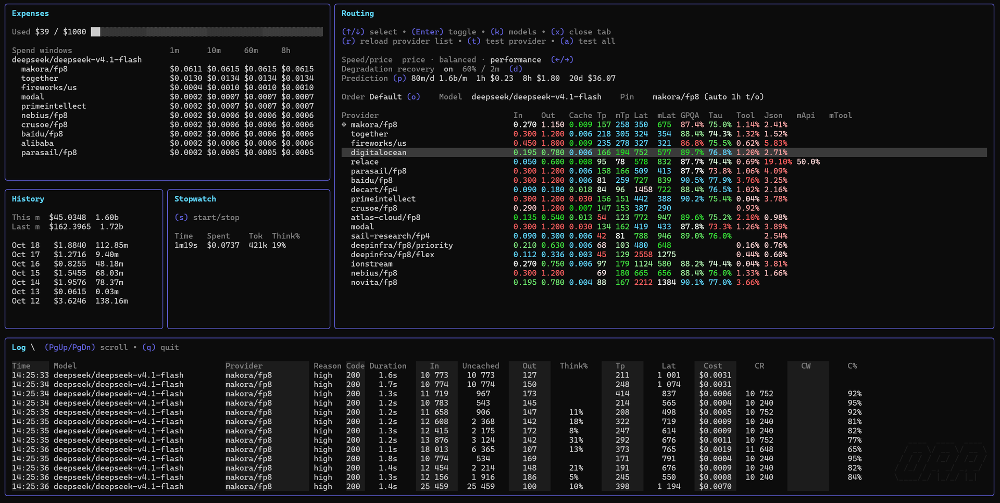

# orr

`orr` is a local OpenRouter proxy. It keeps the model selected by your client
and applies the provider preferences stored in its database to generation
requests.

It gives you provider routing, manual pins, live performance and spend data, and
a terminal dashboard without recording prompts or API keys.



> A valid OpenRouter API key is required. `orr` does not support keyless use.

## Quick start

Install from the public repository (Git is required, plus Go 1.23+ or Docker
with Buildx):

```sh
git clone https://github.com/mikael-titinovskii/orr.git
cd orr
./install.sh
orr serve
```

On Windows PowerShell:

```powershell
git clone https://github.com/mikael-titinovskii/orr.git
Set-Location orr
.\install.ps1
orr serve
```

The installer asks for `OPENROUTER_API_KEY`, builds `orr`, and adds it to
`PATH` where needed. Set `ORR_OPENROUTER_API_KEY` beforehand for unattended
installs. It also configures installed Kimi Code and OpenCode clients when it
finds them.

Without Go 1.23+, the installer builds `orr` for your platform with Docker and
the repository's `Dockerfile`. Docker is used only for building; `orr` still
runs directly on your machine.

Point any OpenAI-compatible client to:

```text
http://127.0.0.1:8787/v1
```

## Configure routing

Keep secrets and runtime options in `.env`, which is ignored by Git. Provider
order, manual pins, and measurement history live in one SQLite database that
`orr` creates and migrates itself.

```dotenv
# .env
OPENROUTER_API_KEY=sk-or-...
ORR_LISTEN=127.0.0.1:8787
ORR_TUI=true
```

The database is `orr.db` in the platform data directory
(`%LocalAppData%\orr` on Windows, `$XDG_DATA_HOME/orr` or
`~/.local/share/orr` elsewhere). Point `ORR_DB_FILE` at another path to keep
several installations apart. A relative value resolves against the dotenv
file's directory.

Routing rows are written by the dashboard, the management API, and background
refreshes; the database is not meant to be edited by hand. `orr` creates an
empty entry for a new model and refreshes its compatible providers
automatically, and it imports a `stats.json` left by an older version once, then
renames it to `stats.json.imported`. `providers.yaml` from an older version is
not migrated; delete it.

Run one `orr serve` per database. Two processes on the same file serialise on
SQLite's write lock, and the second one's startup can fail while the first holds
it; give each its own `ORR_DB_FILE` instead.

Keep `ORR_LISTEN` on `127.0.0.1` unless you deliberately want network access.

## Everyday commands

| Command | Purpose |
| --- | --- |
| `orr serve` | Start the local proxy and dashboard. |
| `orr serve --no-tui` | Start the proxy and management API with plain logs. |
| `orr providers <model>` | List compatible OpenRouter providers for a concrete model id. |
| `orr reset` | Remove the database; preserves `.env`. |
| `orr upgrade` | Pull or download the latest source and rebuild the running binary with Go, or Docker when no usable Go toolchain is installed. |
| `orr completion <shell>` | Print completion setup for bash, zsh, fish, or PowerShell. |

Before tagging a release, update `Version` in `internal/app/main.go` to match
the tag. The dashboard compares this value with release tags, and `orr version`
reports it. After upgrading, restart `orr serve` to run the new executable.

Use a different dotenv file when needed:

```sh
orr serve --env ./local.env
orr providers moonshotai/kimi-k3 --env ./local.env
```

Process environment variables override values from the dotenv file by default.
Use `--prefer-env-file` when the selected file should win for variables it
defines:

```sh
orr serve --prefer-env-file
orr providers moonshotai/kimi-k3 --env ./local.env --prefer-env-file
```

## Upgrading

Two behaviours changed for installations that never set the variables behind
them.

- **Loop recovery is on.** `ORR_LOOP_DETECTION` defaults to `recover`, so a
  streamed answer that starts repeating itself is cut there and continued with
  one extra upstream request. That request is billable and counts against your
  OpenRouter rate limits, and the recovered request's row understates the spend
  because the cut leg's own usage never arrives (see
  [Loop detection](#loop-detection)). A repeat in the model's *thinking* is cut
  and restarted the same way, with the same one extra request, as long as the
  answer itself had not started.
- **A single rate limit moves the pin.** `ORR_429_FAILOVER_THRESHOLD` defaults to
  `1`, so an automatic pin moves to another provider on the first
  provider-attributed 429 instead of passing that 429 on to the client.

To restore the previous behaviour, set both:

```dotenv
ORR_LOOP_DETECTION=off
ORR_429_FAILOVER_THRESHOLD=2
```

`observe` is the quieter middle ground for loop detection: the output is
untouched and no extra request is made, and the request log still marks the
responses that would have been cut.

## Management API

`orr serve` also exposes a REST API at `http://127.0.0.1:8787/api/v1`, with or
without the dashboard. Local management requests require no authentication header.
ORR reads `OPENROUTER_API_KEY` through its existing environment/dotenv configuration
for upstream operations. Read stats and model/provider state, set or clear manual
pins, and submit provider refresh or benchmark jobs. Benchmark jobs make billable
upstream requests. Poll the job URL returned in the `Location` header.

See the [REST API specification](docs/rest-api.md) for endpoints, JSON fields,
examples, limits, and errors. Management changes share the dashboard's live
routing state and persist manual pins to the database.

The management API is accessible to anyone who can reach `ORR_LISTEN`, so keep
the default loopback address for local use.

While running, open [the API reference](http://127.0.0.1:8787/api/docs) or download
[OpenAPI JSON](http://127.0.0.1:8787/api/openapi.json) to import into an API client.
Both documentation endpoints are public and bundled into the binary, with no
CDN dependencies. The [schema source](internal/app/api_docs/openapi.json) is also
available in the repository.

## Dashboard

An interactive terminal opens the dashboard; redirected output uses plain logs.
Set `ORR_TUI=false` or pass `orr serve --no-tui` to always use plain logs.
The indicator beside Log spins while requests are in flight.

The useful controls are:

| Key | Action |
| --- | --- |
| `↑` / `↓` | Select a provider. |
| `Enter` | Toggle a manual pin for the selected provider. |
| `←` / `→` | Move the speed/price control between its stops. |
| `d` | Turn degradation recovery on or off. |
| `p` | Change the day the `Prediction` line prices: 10m to 200m tokens in steps of ten million. |
| `Tab` | Switch between recently used models. |
| `k` | Search the model catalog and open the highlighted model in a tab. |
| `x` | Close the current model tab. |
| `r` | Refresh and rank providers for the current model. |
| `o` | Change the provider table's display order: routing order, then each metric column. |
| `t` | Benchmark the selected provider. |
| `a` | Benchmark every listed provider. |
| `O` | Probe which provider OpenRouter's default routing picks, and mark its row with `o`. |
| `s` | Start or stop the spend stopwatch. |
| `q` / `Ctrl+C` | Stop the proxy cleanly. |

`o` reorders the rows on screen only: the routing order, the pin, and the
stored provider order stay as they are, so requests keep following the same route.
The `Order` field in the routing pane names the active column, the column's own
name is highlighted in the table, and each press of `o` moves to the next column
before returning to `Default`. Prices sort cheapest first, `Tp`/`mTp`, `GPQA`, and
`Tau` fastest or highest first, latencies lowest first, and the error columns
cleanest first; a provider with a blank cell for the active column sorts below
every provider that reports one.

`O` answers what OpenRouter would have chosen on its own. It sends one minimal
request with no provider preferences — the same shape as a `t` benchmark but
without the pinned provider — so OpenRouter's default routing picks the endpoint,
and then marks the chosen provider's row with a trailing `o`. The mark expires on
the same window as the measured metrics. The request is real and billable, so it
is recorded like a benchmark round.

`k` opens a search box over the dashboard. It lists the models the dashboard
already knows and, once the OpenRouter catalog arrives, every model the catalog
publishes, matched by id or display name; ↑/↓ moves the cursor and `Enter` opens
the highlighted model. The model joins the tab list even if nothing has
requested it yet, and its routing entry is created in the database so its
compatible providers can be listed and pinned. `x` closes the displayed tab and moves to
the next one; a request that completes for the closed model afterwards brings it
back, so closing a tab whose traffic is still in flight is temporary.

The `Prediction` line under the header projects what the highlighted provider
would cost over the next hour, the next eight hours, and the next 20 working
days. It prices one day of tokens — 20 million unless `p` changes it — split the
way auto selection's reference request splits it (2,000 uncached input, 30,000
cached input, and 200 output tokens), against that provider's published
prices; the label names the day it prices and the key that changes it. Pressing
`p` cycles 10m to 200m tokens per day in steps of ten million, cycling back to
10m. The label quotes the day and the 20-working-day month it adds up to, so the
volume is never an abstract number: `20m/d 400m/m`. The workload never
follows live traffic, so the figures change only when you change the day, move
the selection to another provider, or that provider reprices; the chosen day
stays in memory and resets with the process. The 20-day value assumes an
eight-hour working day at today's prices. The line stays out when the provider
is blocked for the account, when its catalog entry is missing a price the
projection needs, or when the pane is too narrow for all three horizons.

The provider table includes OpenRouter's published `GPQA` Diamond and `Tau`
Airline benchmark scores, plus `Tool` and `Json` error rates. Benchmark
scores use OpenRouter's rolling 32-day window; error rates match the website's
one-week average of available daily percentages. `mApi` and `mTool`
continue to show errors observed by this proxy.
The legend above the table identifies token rates, first-token latency in milliseconds, OpenRouter benchmarks, and
weekly average OpenRouter tool/JSON error rates, and measured API/tool error rates.
`Tp` (throughput) and `Lat` show OpenRouter's published throughput and
latency; `mTp` and `mLat` show measurements from this proxy. Latency is
time to first token in both cases, matching OpenRouter's definition.
The columns after `mLat` are `GPQA`, `Tau`, `Tool`, `Json`, `mApi`, and
`mTool`. `GPQA` and `Tau` percentages are colored on the
same red–green–teal scale as throughput: higher scores are better, relative to
the listed providers for that model. The provider table shows the cache-read
price in `Cache`; cache-hit percentages are shown in the request log.
The request log's own columns are `In`, `Uncached`, and `Out` for input,
uncached-input, and output tokens, `CR` and `CW` for cache reads and writes,
and `C%` for the cached share of the input. A request whose response began
repeating itself carries a loop mark before its status: `↺` when the repetition
was only detected, `↺!` when the stream was cut there, and `↺+` when a
continuation was spliced over the cut. The mark says the response repeated; the
suffix says what `orr` did about it.
Every other column of the request log carries a subtle background shade so
values stay distinguishable across the table's full width; failed requests keep
the error red across the whole row.
The table scrolls with provider selection to keep the selected provider's
metrics visible within the pane.
`mApi`, `mTool`, `Tool`, and `Json` use pale red for the lowest nonzero rates, increasing
to the current error red for the highest rates, comparing each column
independently. Equal nonzero rates use the strongest red.

These metrics load in the background, refresh every 15 minutes, and refresh
again after `r`. Missing data stays blank, and zero error rates stay blank.
Scores are matched to exact provider endpoints; ambiguous deployments stay
blank. The data comes from OpenRouter's website API, which can change separately
from its documented API. Fetch failures leave unavailable fields blank. The
metrics stay in memory and influence automatic benchmark selection as described below.
See [OpenRouter's Auto Exacto documentation](https://openrouter.ai/docs/guides/routing/auto-exacto)
for how the benchmarks and tool-call errors are measured.

Manual pins stay until removed. Automatic pins select the best measured
provider, expire after `ORR_PIN_TTL` (one hour by default), and move on the first
provider-attributed 429 or an unavailable endpoint. The recovery benchmark a
failure starts is held to a 30-second cooldown per model, saved in the database,
so a restart does not hand the same failing provider a fresh run.

A client should not have to spend a retry on a 429, because clients that never
retry — a subagent worker is the case this is for — die on the first one. A rate
limit OpenRouter attributes to the selected provider moves the pin to another
provider of the same model immediately, and the request is answered without the
client spending a retry. A 429 that no provider change can answer is absorbed
instead: at most one wait per request — a quarter of a second, or the response's
`Retry-After` when it asks for three seconds or less, ending at once if the
client hangs up — and then one retry of the same request. A longer `Retry-After`
is not waited out at all: that 429 goes to the client as it arrived, with no
retry, because the provider has already said when it will accept the request
again and a replay inside that window would spend the request's one retry on a
refusal. Absorption covers a manual pin, which never moves, and an account-wide
limit that names no provider — the shape several clients sharing one API key run
into — whatever the threshold is. An automatic pin earns the same absorption
only once the threshold has been reached with nothing else eligible to move to.

The invariant is one replay per client request, and the 429 after it: however
many attempts a request's route chain takes, `orr` replays it at most once, and
the next 429 is the answer the client receives. In a chain of limited providers
that is the third 429, not the second. When the selected provider is limited and
the provider it failed over to is limited too, the first 429 is answered by the
failover, the second by the one replay, and the client receives the third. Past
that bound nothing is absorbed again, so a provider that keeps answering 429 and
a manually pinned model whose provider stays rate-limited both deliver their 429
unchanged.
`ORR_429_FAILOVER_THRESHOLD` (default `1`) is the setting behind that: it counts
automatic pins only, and it is how many attributed 429s one provider gets before
the pin moves. A manual pin never moves, so it always absorbs the first 429
whatever the value; raising the threshold is what restores the older tolerance
for an automatic pin, whose single 429 is then passed through and has to be
retried by the client.

A rate limit is treated as a burst, not as a verdict: a provider that answered
429 is out of automatic selection, out of failover candidates, and out of
automatic benchmark runs for about two minutes, and is eligible again after that
without any request from you. An endpoint that is unavailable, rather than
merely rate-limited, keeps that exclusion for the 30 minutes the measured
metrics live.

A conversation that replays encrypted reasoning can only continue on the
provider that produced it. When the automatic pin has moved since, orr retries
that request once on the producing provider and leaves the pin where it is. With
a manual pin, OpenRouter's error reaches the client unchanged. In both cases the
error is not counted against the pinned provider.

Measurement follows the models clients ask for. A request for a model whose last
measurement is more than five minutes old starts one catalog refresh and one
provider benchmark for that model, in the background while the request itself
rides the stored pin; a model nobody asks for is never measured. A manually
pinned model is not measured at all: the order under your pin decides nothing, so
the run would spend billable provider requests on a choice it cannot make.
Removing the pin brings the catalog refresh back on the next request and the
benchmark back as soon as that model's last measurement is due, within the same
five minutes. The pings get
their own three-second gate after that model's refresh completes, so a slow
catalog never spends the budget the measurements need, and every provider is
measured until the gate runs out rather than stopping at a share of the field.

Auto selection balances cost, speed, and quality. It estimates the cost and
duration of a typical request from recent traffic (or a reference request of
2,000 uncached input, 30,000 cached input, and 200 output tokens, the shape a
coding client's day actually has). Duration is
time to first token plus output tokens divided by measured tokens per second.
Providers within 1.5 times the field's median duration rank first, followed by
providers with complete prices and trustworthy first-token measurements.
Within these tiers, the lowest quality-adjusted cost-times-duration score wins.

The score's speed/price exponent has three settings, and the Routing pane draws
them as a control just below the key hint:

```
Speed/price  price · balanced · performance  (←/→)
```

The current stop is lit. `←` and `→` move between them: `price` drops duration
out of the score entirely, `balanced` scores the plain `cost * duration`
product, and `performance` buys speed aggressively. The exponents in between are
arithmetic the score still accepts, not settings the pane offers: a decimal
weight is not a decision anyone makes. Like the degradation line below it, the
control carries its own keys so it still says how to move after the key hint has
truncated: a pane too narrow for all three names shows the current stop with the
keys, then the keys alone, and only then truncates the line.
Every keypress re-picks the automatic pin from the measurements already held, so
the pane answers immediately instead of waiting for the next benchmark. The
decision rules are the benchmark's, including the 5% switch threshold, so a move
cannot hand the pin to a provider a benchmark run would have refused at that
weight. The provider order in the database is left alone — only the pin moves — and
catches up on the next benchmark run. The chosen stop is saved alongside the rest
of the routing state, so it survives a restart. A manual pin remains authoritative
and is never overridden by the control.

### Degradation recovery

The speed/price control decides who *should* serve the next request from
measurements orr already holds. Degradation recovery covers the other failure
mode: the chosen provider still answers, but far worse than it did for the same
client minutes ago. It applies only to automatic pins — a manual pin is an
explicit instruction and is never second-guessed.

It compares one provider against itself. For the active route it takes the
answered requests from the last `ORR_DEGRADATION_WINDOW` and the same provider's
successful client requests from the previous 30 minutes, then scores three
ratios, each clamped at 1 so a burst of speed cannot average away a collapse
elsewhere:

```
throughput     recent tokens/sec     / baseline tokens/sec
responsiveness baseline first token  / recent first token
reliability    recent answering share
```

The score is their geometric mean: 1.0 is unchanged, and `ORR_DEGRADATION_THRESHOLD`
(default `0.6`) is the line. One vital at 21% of baseline trips it, two vitals at
46% each trip it, and all three at 60% each trip it — a single wobble does not
spend a benchmark, but a real sag in more than one vital does. A provider needs
`ORR_DEGRADATION_MIN_SAMPLES` answered requests in the window before it is judged
at all, and a provider with no earlier traffic has no baseline, so nothing
happens. Benchmark pings never enter the comparison: they are a fixed 16-token
round whose throughput and latency describe the benchmark, not the client.

A trip runs one bounded catalog refresh and benchmark — the same path provider
failure recovery uses, spending real OpenRouter requests. `ORR_DEGRADATION_COOLDOWN`
(default `10m`) is the minimum gap between attempts for one model, and
`ORR_DEGRADATION_TIMEOUT` (default `10s`) bounds how long that attempt may take.
The convicted provider's pooled benchmark rounds are dropped before that run, so
ranking weighs what it does now instead of a week of healthy pings that no longer
describe it. Ranking still decides the winner under the current speed/price stop,
including its 5% switch threshold, so a benchmark that finds nothing better
leaves the pin alone.

Press `d` to turn degradation recovery on or off; the Routing pane shows the
switch under the speed/price control, with its threshold and window while it is
on. `ORR_DEGRADATION` seeds the state on every start until you press `d`; from
then on the saved switch wins, the same rule the speed/price stop follows. Until
it has been toggled it is not written to the database at all, so the variable
keeps working on installs that never press the key. On a fresh state degradation
recovery starts on.

GPQA, Tau, tool-call success, and JSON success contribute equally to quality.
GPQA and Tau are fractions; success is one minus the published error percentage
divided by 100. Missing or invalid metrics contribute a neutral 0.5. Their
average, `quality`, adjusts the score as
`cost * duration * (1.25 - 0.5 * quality)`, bounded to a 25% discount or penalty
on the cost-speed score. With all quality data missing, the multiplier is 1.
Quality cannot bypass latency tiers or provider health exclusions. A current
eligible automatic pin stays until a challenger improves the adjusted score
by at least 5%. Manual pins remain authoritative.

Quality data loads alongside provider benchmarks even without the dashboard and
shares a 15-minute cache with the dashboard. It is not on the selection path:
the ranking applies the measurements as soon as the pings finish, so a slow
quality fetch cannot delay the pin. Unavailable or expired quality data uses the
neutral adjustment. Failed or cancelled fetches do not start a new cache
lifetime: the next benchmark can retry immediately, and the dashboard retries
after 30 seconds. The dashboard uses the shared data's original fetch timestamp.
Pressing `r` invalidates quality data, including results from fetches already in
flight.

## Integrations

`orr integrate` updates Kimi Code and OpenCode after either client is installed.
You can also change only the OpenRouter base URL yourself.

Kimi Code uses the standalone `kimi` command and `~/.kimi-code/config.toml`
(or `$KIMI_CODE_HOME/config.toml` when that environment variable is set).
`orr integrate` creates missing configs for installed clients. A new or empty
Kimi config gets an OpenRouter provider with the configured `OPENROUTER_API_KEY`
and `moonshotai/kimi-k3` as its default model, with a 1,048,576-token context window.
The model alias is `openrouter/moonshotai/kimi-k3`, matching registry imports.
Existing Kimi configs keep their model selections and provider protocols; only
OpenRouter providers are patched. Anthropic providers use the proxy's host root
because their SDK adds `/v1/messages`; OpenAI-compatible providers use `/v1`.
For a provider named `openrouter` with type `openai`, integration also adds or
updates the registry `source` block and synchronizes its key with the configured
OpenRouter key (or the provider's existing `api_key`). Both installers run this
integration automatically. Other provider names and protocols retain their
existing setup because the registry declares `openrouter` with type `openai`.
If none exists, add OpenRouter using Kimi's
`/provider` command, select a model, then rerun `orr integrate`.

For an existing OpenRouter provider, its endpoint should be:

```toml
[providers.openrouter]
type = "openai"
base_url = "http://127.0.0.1:8787/v1"
```

The old Python Kimi CLI's `~/.kimi` directory and `KIMI_SHARE_DIR` are not targeted.
Unsupported OpenRouter provider protocols, including `openai_legacy`, `google-genai`,
and `vertexai`, are rejected without changing the file; current Kimi Code uses
`openai` for Chat Completions. Existing files are
backed up to `<config path>.orr-backup` before changes.

OpenCode (`~/.config/opencode/opencode.json`):

```json
{
  "provider": {
    "openrouter": {
      "options": { "baseURL": "http://127.0.0.1:8787/v1" }
    }
  }
}
```

Keep the client’s existing OpenRouter key and model selection. `orr` only adds
routing preferences for each selected model.

## Model registry for Kimi Code

`orr` serves the full OpenRouter model catalog in Kimi Code's models.dev-style
custom-registry format at:

```text
GET http://127.0.0.1:8787/registry.json
```

The document is keyed by the `openrouter` provider id and carries every model
OpenRouter publishes, with context size, max output tokens, tool-call and
reasoning support, input/output modalities, and reasoning efforts. It is fetched
from OpenRouter and cached for five minutes. Unknown token limits are omitted.
If a refresh fails or returns no usable models, the last valid catalog is served;
retries are limited to once every 30 seconds. Until a valid catalog is available,
upstream failures return HTTP 502.

The advertised API URL uses `ORR_LISTEN`, with wildcard bind addresses mapped to
loopback for local clients. Use a concrete address reachable by the client when
accessing the registry from another machine.

Point Kimi Code's OpenRouter provider at it so `/models` refresh auto-imports new
models instead of adding each one by hand. Run `orr integrate` to configure the
standard `openrouter` / `openai` provider, or add the block manually:

```toml
[providers.openrouter]
type = "openai"
base_url = "http://127.0.0.1:8787/v1"

[providers.openrouter.source]
kind = "apiJson"
url = "http://127.0.0.1:8787/registry.json"
apiKey = "sk-or-..."
```

Then run `/models` refresh (or `/reload`) in Kimi Code. Every OpenRouter model is
imported into `~/.kimi-code/config.toml`; the provider's `api_key` comes from
`source.apiKey`, so it must be non-empty.

## Loop detection

A model can get stuck repeating the same sentence, the same code block, or the
same list until the output limit cuts it off. `orr` watches the stream for that
and treats it as a fault of the generation, not of the client's request.

`ORR_LOOP_DETECTION` picks what happens:

| Mode | Behavior |
| --- | --- |
| `off` | Pass the response through byte for byte. Nothing is inspected. |
| `observe` | Pass the response through unchanged and take no action. |
| `abort` | End the response at the point the repeat starts, so the client's stream finishes instead of running to the output limit. |
| `recover` | The default. Cut the repeating tail, ask the model to continue from the cut, and splice the continuation into the one stream the client is reading. |

`recover` is the default because a client still streaming a loop is waiting for
output nobody will read, while a long answer that derails once is usually still
wanted.

Detection only looks at text `orr` has just forwarded. It keeps a fixed 8 KiB
ring of that recent history per channel, whatever the settings say, and a
repeated stretch shorter than `ORR_LOOP_MIN_PERIOD` bytes (32 by default) is
ordinary phrasing rather than a loop. `ORR_LOOP_MIN_REPEAT` (512 by default) is
the shortest exactly repeating suffix that confirms one — a threshold, not the
amount of history held, so raising it makes detection stricter rather than
larger. A whole response is never buffered, so a request's detection memory does
not grow with its length.

What counts as text is fixed, and narrower than the whole stream. Chat
completions contributes `delta.content`, `delta.reasoning`,
`delta.reasoning_content`, and the `reasoning.text` and `reasoning.summary`
items of `delta.reasoning_details`; the Responses API contributes
`response.output_text.delta`, `response.reasoning_text.delta`, and
`response.reasoning_summary_text.delta`; Messages contributes `text_delta`,
`thinking_delta`, and `input_json_delta`. Encrypted reasoning — the
`reasoning.encrypted` items a provider hands back as an opaque blob — is never
measured, because there is no prose in it to compare. On the response it belongs to
it reaches the client untouched; a continuation's own encrypted items are dropped
with the rest of that leg's frames, since they identify a response the client never
opened.

Both settings are byte counts with ends the detector itself sets, and a value
outside them is refused at startup rather than accepted and silently overridden:

- `ORR_LOOP_MIN_PERIOD` is between 8 and 1024. A repeating unit shorter than the
  minimum is rounded up to a multiple of it, and that multiple still has to fit
  inside the 2048-byte stretch tier 1 considers — which is why the accepted
  maximum is half of it: at the full 2048 a 40-byte unit rounds to 2080 and is
  discarded, so detection would silently never fire.
- `ORR_LOOP_MIN_REPEAT` is between 512 and 8192, and at least twice
  `ORR_LOOP_MIN_PERIOD` — a rule that only bites for periods above 256. Tier 2
  never accepts an exactly periodic suffix shorter than 512 bytes, so a smaller
  minimum repetition would be raised to 512 rather than applied. The upper end is
  the fixed 8192-byte ring that history lives in: a minimum longer than the text
  the detector keeps can never be satisfied, so nothing is ever confirmed and
  detection silently never fires. Past the ring the setting does not make
  detection stricter, it turns it off. Inside the range a larger value does
  narrow detection, because fewer repeats are long enough to confirm. A value
  right at the ceiling only fires when a single repeating unit fills the whole
  ring evenly, so the practical setting stays well below it. If the repeats you
  see are longer units rather than longer runs of the same unit, raise
  `ORR_LOOP_MIN_PERIOD` instead.

Recovery then:

1. stops forwarding where the repeat starts and drops the repeated part;
2. sends one more upstream request, with the repetition penalty
   `ORR_LOOP_PENALTY` (default `0.4`) applied to sampling, so it is less likely to
   fall back into the same groove. A repeat in the answer resumes from the text
   already sent. A repeat in the model's *thinking* cannot be resumed, because no
   provider takes a thought back as the assistant's own turn, so it restarts
   instead: the client's own conversation plus one instruction to answer
   directly, with the thought that looped left out. Restarting is only worth a
   request while the client holds nothing yet — no prose and no tool call —
   because afterwards a second answer or a second call would be appended to it;
3. relays that continuation inside the same response body, so the client reads
   one answer rather than two.

`ORR_LOOP_MAX_CONTINUATIONS` (default `1`) is how many such continuations one
response may use; with `0` the cut is where the answer ends. A value above `1`
adds nothing: a continuation that repeats itself ends the answer instead of being
continued again, because resuming the text it just failed to escape would spend
another request to arrive back at the same verdict.

What the client receives is one response, not two stitched together:

- **One identity.** The continuation opens a message of its own upstream, and
  those opening frames are dropped: the client already has the `message_start`,
  `response.created`, or role frame of the response it is reading.
- **One terminator.** The aborted leg's finish frames never reach the client. The
  response ends with the same sequence `abort` writes — a `finish_reason` chunk
  and `[DONE]` for chat completions, `response.completed` for the Responses API,
  and `content_block_stop`, `message_delta`, and `message_stop` for Messages —
  written once, after the spliced text.
- **A usage figure on Messages, and only there.** The continuation's own usage
  frame is dropped with the rest of its non-text frames. A `/v1/messages` client
  is told the continuation's output-token estimate in `message_delta`; chat
  completions and the Responses API carry no usage in their terminal frames,
  exactly as in `abort`.
- **Messages recovery is best-effort for anything but single-block text.** The
  reframer forwards every `text_delta`, `thinking_delta`, and `input_json_delta`
  frame byte for byte with the index it arrived with, and drops the continuation's
  own `content_block_start`; it never compares that index with the block the client
  has open. A continuation whose first block is thinking or tool use, or one that
  opened a second block, therefore hands the client deltas for a block it never saw
  start. A single-block text continuation, which is what a repeated answer
  produces, splices cleanly.
- **Comments while it waits.** Between the cut and the continuation's first token
  the client receives SSE comment lines (`: `), which every event-stream parser
  ignores. They keep a client with an idle-read timeout from treating the wait as
  a dead stream, and no empty `data:` frame is ever sent.

Recovery falls back to a plain cut — the answer ends where the repetition was
confirmed, with the same terminator — whenever a continuation cannot be used at
all: the repeat was in tool-call arguments (a truncated JSON prefix is not a turn
a model can continue), the repeat was in the reasoning channel after the client
had already been handed prose or a tool call (a restart there would append a
second answer or a second call), the answer repeat had no clean text before it to
resume from, `ORR_LOOP_MAX_CONTINUATIONS` is `0`, or the continuation request was
refused, rate-limited, timed out, or answered with something that is not an event
stream. That request is marked `↺!` in the dashboard, and the plain log names the
reason.

A splice can also end early and still be both. The text the continuation did
generate is spliced in, so the client still receives a complete-looking answer and
the request is marked `↺+`, and the answer then ends where the continuation stopped
— either because it repeated itself, or because its stream broke off mid-splice.
The log line names which of the two instead of leaving it at "stream recovered":

```
loop detected in /v1/chat/completions for <model>: 69 bytes repeated 15 times; stream recovered, then ended: continuation repeated itself
loop detected in /v1/chat/completions for <model>: 69 bytes repeated 15 times; stream recovered, then ended: continuation stream ended early
```

Either way the client still receives a valid terminator, and the answer it holds is
only the part of the continuation that arrived.

Recovery is not a passive inspection, and its cost is real:

- **One extra upstream request** per recovery. It is billable, and it counts
  against your OpenRouter rate limits. It is not a second client request: it never
  appears in the request log, the request counts, or a provider's health, and its
  tokens and cost are added to the row of the request it continued.
- **A slow token at the cut.** The gap between the last token before the cut and
  the first token of the continuation reads like a slow token; the comment lines
  above are what keep it from reading like a dead connection.
- **A row that understates the spend.** A recovered request's row carries what the
  cut leg reported — normally nothing, because the cut closes the stream before its
  usage frame arrives — plus the continuation's own usage, or the estimate from the
  text it generated when it reported none. What it cannot carry is the cut leg's own
  prompt and the prefix that leg generated: that prompt was the whole conversation,
  re-sent and re-billed on the second leg, and its usage frame never arrived. Read
  the row as a lower bound on what the answer cost.

Turn the feature off in `.env` and restart `orr serve`:

```dotenv
ORR_LOOP_DETECTION=off
```

`observe` is the middle ground for deciding whether to keep the feature: the
output is untouched and no extra request is made.

## Runtime options

| Variable | Default | Purpose |
| --- | --- | --- |
| `ORR_TUI` | `true` | Enable the interactive dashboard. |
| `ORR_PIN_TTL` | `1h` | Lifetime of automatic pins. |
| `ORR_429_FAILOVER_THRESHOLD` | `1` | Provider-attributed 429s an automatic pin tolerates before the model moves to another provider; `1` moves on the first, and a higher value lets a 429 reach the client first. A manual pin never moves and is unaffected. |
| `ORR_LOG_REQUESTS` | `true` | Emit completed request lines in plain-log mode. |
| `ORR_UPDATE_MAX_PROVIDERS` | `20` | Maximum providers kept after a refresh. |
| `ORR_UPDATE_CACHE_ONLY` | `false` | Prefer only prompt-cache-capable providers. |
| `ORR_DEGRADATION` | `true` | Seed the degradation recovery switch; the last `d` press wins over it. |
| `ORR_DEGRADATION_THRESHOLD` | `0.6` | Share of a provider's own baseline vitals that still counts as healthy. |
| `ORR_DEGRADATION_WINDOW` | `2m` | How long the drop must hold; positive and shorter than the 30m baseline. |
| `ORR_DEGRADATION_MIN_SAMPLES` | `3` | Answered requests required in the window before vitals are judged. |
| `ORR_DEGRADATION_COOLDOWN` | `10m` | Minimum gap between recovery benchmarks for one model; must be positive. |
| `ORR_DEGRADATION_TIMEOUT` | `10s` | How long one recovery refresh and benchmark may take. |
| `ORR_LOOP_DETECTION` | `recover` | What to do when a streamed response repeats itself: `off`, `observe`, `abort`, or `recover`. |
| `ORR_LOOP_MIN_PERIOD` | `32` | Shortest repeating stretch, in bytes, that counts as a loop; between 8 and 1024. A shorter unit is rounded up to a multiple of this, and that multiple must still fit the 2048-byte stretch the detector considers, so values above 1024 are refused rather than left to disable detection. |
| `ORR_LOOP_MIN_REPEAT` | `512` | Shortest exactly repeating suffix, in bytes, that confirms a loop; between 512 and 8192, and at least twice the period. It sets the confirmation threshold, not the history held: the ring is a fixed 8 KiB. A smaller value would be raised to 512; above 8192 no repeat fits in the ring and detection never fires. |
| `ORR_LOOP_MAX_CONTINUATIONS` | `1` | Continuations `recover` may request for one response; 0 allows none. |
| `ORR_LOOP_PENALTY` | `0.4` | Repetition penalty applied to the recovery request; between 0 and 2. |

`OPENROUTER_API_KEY` also enables benchmarks, usage tracking, and account
metrics. Client requests still use the client’s own authorization header.

## Provider selection

`orr` compares healthy, tool-capable providers using estimated request cost and
measured response time. It favors the lowest cost-delay tradeoff, avoids
unusably slow choices, and keeps a small margin to prevent pin churn. Manual
pins always win.

Benchmarks make real, billable OpenRouter requests. The dashboard stores stats,
automatic pins, and benchmark results in the database outside the repository;
`orr reset` removes it.

## Development

```sh
go test ./...
go vet ./...
```

The end-to-end suite uses local mock upstreams and does not need a real OpenRouter
key or network access.

Build a binary for any supported platform without a local Go toolchain:

```sh
docker build --platform darwin/arm64 --output dist .
```

The result is `dist/orr` (`dist/orr.exe` for `windows/*` platforms).

Run the deterministic auto-selection snapshot tests with:

```sh
go test ./internal/app -run TestAutoSelectionSnapshots -v
```

Fixtures in `internal/app/testdata/auto_selection*_snapshots.json` declare
provider prices, measured speed and TTFT, quality metrics, pin state, and the
expected winner. Each scenario checks multiple provider listing orders and
repeated selection. The Kimi K3 screenshot fixture preserves missing measured
data; separate hypothetical cases explicitly assume benchmarks reproduce the
published throughput with 500 ms TTFT.
